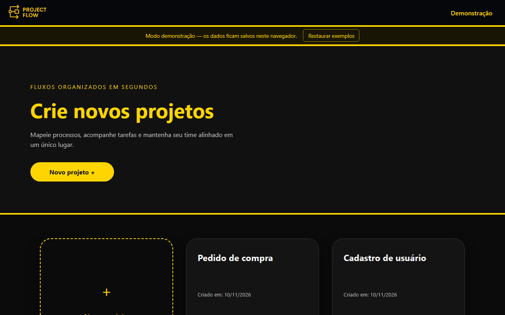
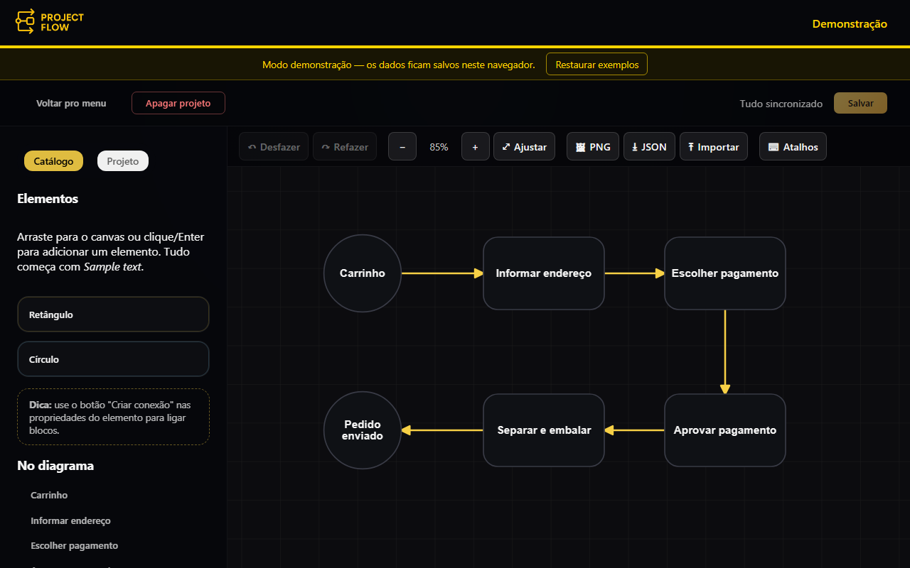

# ProjectFlow

[English](README.md) | **Português (Brasil)**

[](https://github.com/TiagoJSaraiva/ProjectFlow-webapp/actions/workflows/deploy.yml)

O ProjectFlow é um **editor web de diagramas de fluxo**. Você cria projetos, coloca retângulos e círculos em um
canvas, liga tudo com setas e guarda o resultado salvo, exportado ou compartilhado como arquivo. O front-end é uma
aplicação Angular 22 de página única que desenha o diagrama com [Konva](https://konvajs.org/).

> ### Demonstração online
>
> **<https://tiagojsaraiva.github.io/ProjectFlow-webapp/>**
>
> O site publicado roda em **modo demonstração**: não há login nem servidor. Seus projetos ficam no `localStorage`
> do navegador (permanecem somente naquele navegador e naquele dispositivo). Na primeira visita o app cria dois
> projetos de exemplo ("Cadastro de usuário" e "Pedido de compra") para não começar vazio, e um aviso permanente no
> topo oferece **Restaurar exemplos**, que pede confirmação e então substitui tudo pelos dois exemplos novamente.

| Projetos | Board |
| --- | --- |
|  |  |

## Sumário

- [Funcionalidades](#funcionalidades)
- [Atalhos de teclado](#atalhos-de-teclado)
- [Stack e arquitetura](#stack-e-arquitetura)
- [Estrutura de pastas](#estrutura-de-pastas)
- [Pré-requisitos](#pré-requisitos)
- [Instalação e execução](#instalação-e-execução)
- [Configuração](#configuração)
- [Uso com o servidor ProjectFlow](#uso-com-o-servidor-projectflow)
- [Scripts](#scripts)
- [Testes](#testes)
- [Implantação (GitHub Pages)](#implantação-github-pages)
- [Detalhes de implementação e limitações conhecidas](#detalhes-de-implementação-e-limitações-conhecidas)
- [Créditos](#créditos)

## Funcionalidades

**Editor (nos dois modos)**

- Projetos: listar, criar (com o nome "Projeto N"), abrir e excluir (com confirmação). Um projeto tem nome e descrição,
  editados na aba **Projeto** da barra lateral do board.
- Nós: **retângulo** e **círculo**. Adicione-os arrastando da paleta ou clicando em um botão da paleta (o nó aparece no
  meio da área visível) e edite o título (até 35 caracteres, com contador) e a descrição na barra lateral.
- Conexões com **seta** do nó de origem ao nó de destino. Crie com o botão "Criar conexão" (ou a tecla `C`) e clique/
  selecione o nó de destino. A linha é um caminho em "L" ancorado nas bordas dos nós e é recalculada enquanto você
  arrasta os nós.
- Mover nós (mouse, toque ou setas do teclado), **redimensionar** (arraste a alça exibida no nó selecionado ou digite
  largura/altura ou raio na barra lateral), renomear e excluir.
- **Desfazer / refazer** para criar, mover, renomear, redimensionar, conectar e excluir (histórico de até 100 passos;
  digitar um título e mover várias vezes com as setas viram um único passo).
- Pan (arrastar o fundo), zoom (roda do mouse, botões da barra de ferramentas ou pinça com dois dedos em telas de
  toque) e **ajustar à tela**.
- **Exportar** o diagrama inteiro como **PNG** (não só a área visível) ou **JSON**, e **importar** um arquivo JSON. A
  importação é validada e mostra uma mensagem de erro clara quando o arquivo não é válido.
- **Salvar**, com aviso de alterações não salvas ao sair do board, recarregar ou fechar a aba.
- Alternativas ao arrastar para uso por teclado: lista de nós na barra lateral, `[` / `]` para selecionar nós, botões
  da paleta que adicionam nós e uma lista de atalhos dentro do app (botão "Atalhos").
- Estados de carregamento, vazio, erro (com "Tentar novamente") e sucesso na lista de projetos e no board; diálogos
  acessíveis (foco preso, `Esc`, `aria-modal`).

**Somente com o backend** (`demoMode: false`)

- Cadastro com **verificação por e-mail**, **login**, **recuperação de senha** e redefinição, tratamento de sessão (o
  token é anexado às chamadas da API; uma sessão expirada (HTTP 401) limpa a sessão e leva de volta ao login com um
  aviso) e persistência de projetos e diagramas no servidor.

## Atalhos de teclado

Os atalhos funcionam no board quando você não está digitando em um campo de texto (exceto `Ctrl+S`).

| Teclas | Ação |
| --- | --- |
| `Ctrl+S` | Salvar o projeto |
| `Ctrl+Z` | Desfazer |
| `Ctrl+Y` ou `Ctrl+Shift+Z` | Refazer |
| `[` e `]` | Selecionar o nó anterior / seguinte |
| Setas | Mover o nó selecionado 10 px (`Shift`: 50 px) |
| `Delete` ou `Backspace` | Excluir o nó selecionado |
| `Enter` | Editar o título do nó selecionado (ou concluir a conexão no modo de conexão) |
| `C` | Iniciar uma conexão a partir do nó selecionado |
| `Esc` | Cancelar a ação atual / limpar a seleção |

## Stack e arquitetura

- **Angular 22** com componentes standalone e **signals** (sem NgModules), TypeScript 6, RxJS 7 e CSS puro (sem
  biblioteca de UI).
- **Konva 10** usado diretamente (sem wrapper) para o canvas.
- Karma + Jasmine nos testes; GitHub Actions + GitHub Pages para CI/CD.

Como as peças se encaixam:

- **Camada de dados.** As telas dependem da classe abstrata `ProjectRepository` (listar, criar, carregar diagrama,
  salvar diagrama, excluir). Há duas implementações, escolhidas na inicialização por `environment.demoMode`
  (`provideProjectRepository`):
  - `HttpProjectRepository` fala com a API REST (e normaliza as datas ISO-8601 devolvidas pelo servidor);
  - `LocalProjectRepository` guarda um único documento JSON no `localStorage` (`projectflow_demo_v1`), cria os dois
    projetos de exemplo (`demo-seed.ts`) e imita as validações do servidor (limite do nome do nó, 404 para projeto
    inexistente).
- **Estado do board.** `DiagramStore` (fornecido pelo componente do board) mantém o estado como signals e todas as
  operações de edição. Ele possui o `History` de desfazer/refazer (snapshots imutáveis com chaves de agrupamento) e não
  conhece Konva nem HTTP.
- **Renderização.** `DiagramRenderer` encapsula o stage do Konva (camadas de grade, conexões e nós), desenha nós, setas
  e a alça de redimensionamento, trata pan, zoom por roda e pinça, gera a exportação em PNG e informa as ações do
  usuário por uma pequena interface de eventos.
- **Funções puras.** `connection-geometry.ts` (caminhos em "L" ancorados nas bordas, limites), `viewport-math.ts`
  (zoom em torno de um ponto, ajustar ao conteúdo) e `diagram-io.ts` (exportação/importação JSON e validação) são
  funções simples com testes unitários.
- **Componentes.** `ProjectBoardComponent` liga rota, repositório, store e renderizador, além dos atalhos de teclado e
  do fluxo de alterações não salvas. `BoardToolbarComponent`, `DialogComponent` e `DemoBannerComponent` são peças
  pequenas e reutilizáveis.
- **Sessão.** `AuthService` (token no `localStorage`, checagem de expiração do JWT), `authGuard`, `authInterceptor`
  (adiciona o cabeçalho `Authorization` somente às chamadas da API e trata 401) e `getApiErrorMessage` (usa o campo
  `message` dos erros da API).

## Estrutura de pastas

```text
src/
  environments/            environment.ts (produção, demoMode ligado) e environment.development.ts
  app/
    app.config.ts          providers (router, HttpClient + interceptor, escolha do repositório)
    app.routes.ts          rotas; as rotas de autenticação redirecionam para "/" no modo demonstração
    auth/                  telas de login, cadastro, recuperação, redefinição de senha e verificação de e-mail
    data/                  ProjectRepository, implementações HTTP e local, dados de exemplo
    landing-page/          lista de projetos
    project-board/         componente do board, DiagramStore, History, DiagramRenderer,
                           funções de geometria/viewport/io, barra de ferramentas
    shared/                tokens de configuração da API, erros da API, diálogo, aviso da demo, auth, download
    header/ footer/        estrutura da aplicação
scripts/prepare-pages.mjs  cria 404.html e .nojekyll após o build do Pages
.github/workflows/         deploy.yml (testes + build em push/PR, publicação na main)
docs/screenshots/          imagens usadas neste documento
```

## Pré-requisitos

- **Node.js** `^22.22.3`, `^24.15.0` ou `>=26` (faixa exigida pelo Angular 22) e npm.
- Google Chrome (ou Chromium) para rodar os testes.

## Instalação e execução

```bash
git clone https://github.com/TiagoJSaraiva/ProjectFlow-webapp.git
cd ProjectFlow-webapp
npm ci
npm start            # desenvolvimento: http://localhost:4200, com contas (demoMode desligado)
```

Para rodar o modo demonstração localmente (sem servidor) use a configuração de produção:

```bash
npm start -- --configuration production
```

## Configuração

A configuração fica em `src/environments/`:

| Arquivo | Usado por | `demoMode` | `apiUrl` |
| --- | --- | --- | --- |
| `environment.development.ts` | `ng serve`, `ng build --configuration development` | `false` | `http://localhost:8080` |
| `environment.ts` | build de produção (o `ng build` padrão) | `true` | `''` (mesma origem) |

`demoMode` seleciona o repositório local, remove a exigência de login e mostra o aviso de demonstração. `apiUrl` é a URL
base da API REST, sem barra final (injetada pelo token `API_BASE_URL`). Para gerar um build de produção que fale com um
servidor real, defina `demoMode: false` e a URL do servidor em `environment.ts`.

## Uso com o servidor ProjectFlow

O backend é uma aplicação Spring Boot separada: <https://github.com/TiagoJSaraiva/ProjectFlow-server>.

1. Inicie o servidor (ele escuta na porta **8080**; veja o README dele para banco de dados e e-mail).
2. Garanta que o servidor aceita a origem do front-end. A configuração de CORS `CORS_ALLOWED_ORIGINS` tem como padrão
   `http://localhost:4200`, onde o `npm start` serve o app.
3. Os links de verificação de e-mail e de redefinição de senha são montados a partir de `FRONTEND_BASE_URL` no servidor;
   aponte-o para o endereço onde este app está servido (o app trata `/verify-email` e `/reset`).
4. Rode `npm start` (configuração de desenvolvimento, `demoMode: false`) e crie uma conta.

## Scripts

| Script | O que faz |
| --- | --- |
| `npm start` | `ng serve` (configuração de desenvolvimento) |
| `npm run build` | Build de produção em `dist/project-flow-webapp/browser` |
| `npm run build:pages` | Build de produção com `--base-href /ProjectFlow-webapp/`, depois cria `404.html` e `.nojekyll` |
| `npm test` | `ng test` (Karma, modo watch) |
| `npm run test:ci` | Execução única em Chrome headless sem sandbox (`ChromeHeadlessCI`), como no workflow |

## Testes

Karma + Jasmine, cerca de 150 testes unitários e de componentes. Cobrem os repositórios (HTTP com
`HttpTestingController`, local com armazenamento em memória e um teste que prova que o modo demonstração **não faz
chamadas HTTP**), a autenticação (service, guard, interceptor), as mensagens de erro, o store do board e o histórico de
desfazer/refazer, a geometria, a matemática do viewport, a validação da exportação/importação JSON, o renderizador Konva
(exportação PNG e alça de redimensionamento) e o diálogo, o aviso da demo, a lista de projetos e a configuração das
rotas, além de testes de componente do board (salvar com sucesso/falha/edição durante o salvamento, apagar, guard de alterações não salvas e atalhos de teclado).

```bash
npm run test:ci          # execução única headless
npm test                 # modo watch com Chrome visível
npx ng test --watch=false --browsers=ChromeHeadless
```

## Implantação (GitHub Pages)

O workflow `.github/workflows/deploy.yml` roda a cada push e pull request para a `main`: instala as dependências, roda os
testes (`npm run test:ci`) e faz o build com `npm run build:pages`. Em um push na `main` ele também envia o build como
artefato do Pages (`configure-pages`, `upload-pages-artifact`) e publica (`deploy-pages`); pull requests apenas testam e
fazem o build. Nas configurações do repositório, o Pages deve usar **GitHub Actions** como fonte.

- O site é servido em `/ProjectFlow-webapp/`, então o build usa `--base-href /ProjectFlow-webapp/` e todos os assets são
  relativos a essa base.
- O GitHub Pages não tem fallback de SPA, então `scripts/prepare-pages.mjs` copia `index.html` para `404.html`: links
  diretos como `/ProjectFlow-webapp/projects/demo-pedido-compra/board` carregam o app (a página é servida com status
  404 e o Angular então trata a rota). O script também cria `.nojekyll`.

## Detalhes de implementação e limitações conhecidas

- **Os dados da demo são locais.** No modo demonstração os dados ficam somente no `localStorage` daquele navegador para
  aquele site; não são compartilhados entre navegadores ou dispositivos e se perdem se os dados do navegador forem
  apagados. Se o `localStorage` estiver bloqueado, a demo mantém os dados só em memória. Armazenamento cheio gera uma
  mensagem de erro em vez de perder dados em silêncio.
- **Limites da importação.** Arquivos JSON de até 1 MB, 500 nós e 1000 conexões; nomes de nó de até 35 caracteres;
  só é aceito o formato gravado pela exportação (versão 1). Nós e conexões importados recebem novos ids e a importação
  substitui o diagrama atual (pode ser desfeita e ainda precisa ser salva). Campos desconhecidos são descartados e os
  tamanhos são limitados (retângulo 80-600 x 50-400, raio do círculo 32-300).
- As datas da API são strings ISO-8601 sem fuso e são interpretadas como UTC (o servidor as gera em UTC); o formato
  antigo em array ainda é tolerado.
- Pan e zoom não marcam o projeto como alterado; a visão atual é gravada na próxima vez que você salvar outras alterações.
- O nome do projeto é enviado sem espaços nas pontas e não pode ficar vazio. Não é possível criar duas conexões entre os mesmos dois nós na mesma direção, e os nós adicionados pelos botões da paleta são posicionados em cascata para não se sobrepor.
- Salvar preserva o histórico de desfazer e a seleção; edições feitas durante um salvamento continuam pendentes (o projeto segue como "não salvo"). Apagar um projeto não pergunta depois sobre alterações não salvas. "Restaurar exemplos" já pede confirmação, então não abre um segundo diálogo de alterações não salvas.
- Se os dados salvos da demo não puderem ser lidos (corrompidos ou de outra versão), uma cópia é mantida em outra chave do `localStorage` (`projectflow_demo_v1_unreadable_<timestamp>`), os exemplos são restaurados e um aviso discreto aparece. Se o armazenamento estiver cheio ou bloqueado, os exemplos ficam só em memória e um aviso explica que as alterações não serão mantidas.
- Projetos novos se chamam "Projeto N" e o número nunca é reutilizado após exclusões (o maior número visto fica guardado no `localStorage`).
- Excluir um nó ou uma conexão não pede confirmação porque pode ser desfeito; excluir um projeto pede.
- O builder do Karma (`@angular-devkit/build-angular:karma`) está deprecado pelo Angular; continua funcionando e foi
  mantido para evitar a migração do executor de testes.
- O `npm audit` não aponta vulnerabilidades nas dependências de produção; as que ele lista estão apenas em ferramentas de
  desenvolvimento.
- Sem verificação visual: o layout foi conferido em um navegador a 360, 768 e 1280 px e a alça de redimensionamento foi
  arrastada com o mouse, mas **os gestos de toque (arrastar e pinça com dois dedos em uma tela de toque real) não foram
  testados**. Em telas muito estreitas os diagramas de exemplo começam parcialmente fora da área visível; use "Ajustar".

## Créditos

Desenvolvido por **Tiago Jarruge Saraiva** (commits com os nomes Tiago Jarruge Saraiva e TiagoJSaraiva). Os diagramas
são desenhados com [Konva](https://konvajs.org/); o framework é o [Angular](https://angular.dev/).
