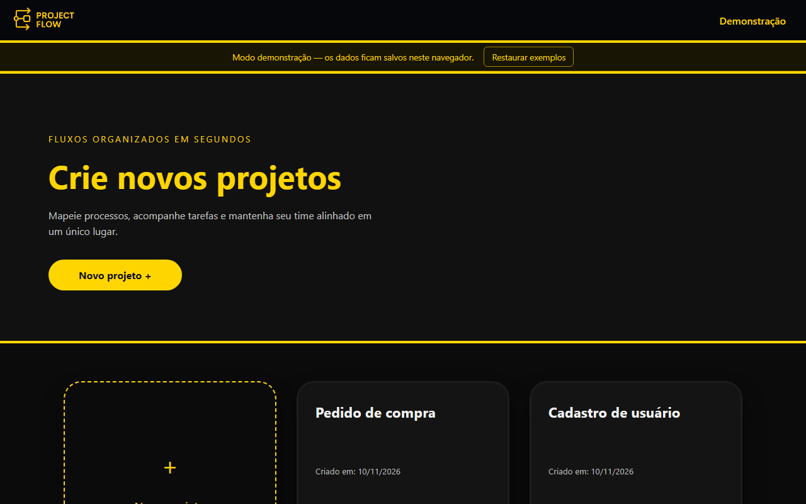
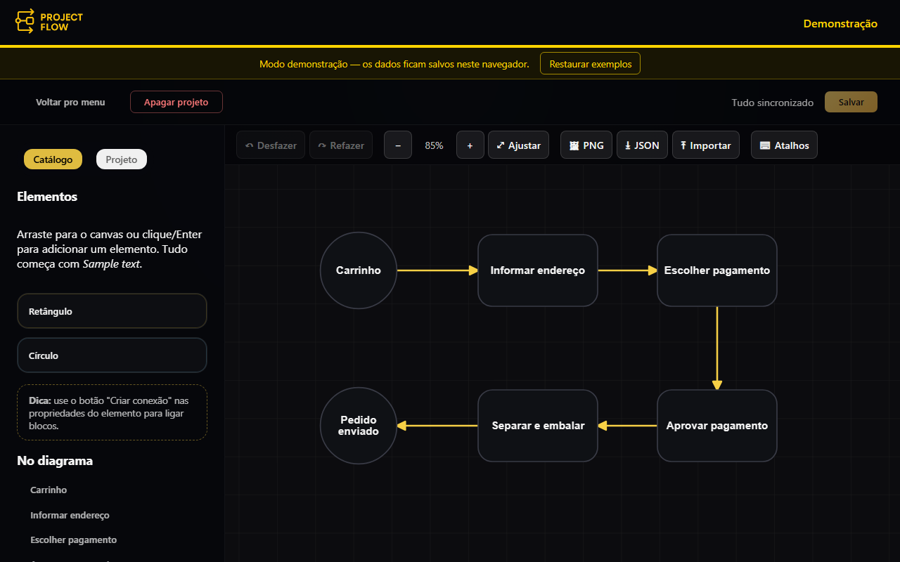

# ProjectFlow

**English** | [Português (Brasil)](LEIA-ME.md)

[](https://github.com/TiagoJSaraiva/ProjectFlow-webapp/actions/workflows/deploy.yml)

ProjectFlow is a web-based **flow diagram editor**. You create projects, drop rectangles and circles on a
canvas, connect them with arrows, and keep the result saved, exported or shared as a file. The front end is an
Angular 22 single-page application that draws the diagram with [Konva](https://konvajs.org/).

> ### Live demo
>
> **<https://tiagojsaraiva.github.io/ProjectFlow-webapp/>**
>
> The published site runs in **demonstration mode**: there is no login and no server. Your projects are stored in
> the browser's `localStorage` (they stay on that browser and that device only). On the first visit the app
> creates two example projects ("Cadastro de usuário" and "Pedido de compra") so it does not start empty, and a
> permanent notice at the top offers **Restaurar exemplos** (restore examples), which asks for confirmation and
> then replaces everything with the two examples again.

| Projects | Board |
| --- | --- |
|  |  |

## Table of contents

- [Features](#features)
- [Keyboard shortcuts](#keyboard-shortcuts)
- [Tech stack and architecture](#tech-stack-and-architecture)
- [Project structure](#project-structure)
- [Prerequisites](#prerequisites)
- [Installation and running](#installation-and-running)
- [Configuration](#configuration)
- [Using it with the ProjectFlow server](#using-it-with-the-projectflow-server)
- [Scripts](#scripts)
- [Tests](#tests)
- [Deployment (GitHub Pages)](#deployment-github-pages)
- [Implementation notes and known limitations](#implementation-notes-and-known-limitations)
- [Credits](#credits)

## Features

**Editor (both modes)**

- Projects: list, create (named "Projeto N"), open and delete (with confirmation). A project has a name and a
  description, edited in the **Projeto** tab of the board sidebar.
- Nodes: **rectangle** and **circle**. Add them by dragging from the palette, by clicking a palette button (the node
  appears in the middle of the visible area), and edit the title (up to 35 characters, with a counter) and the
  description in the sidebar.
- Connections with an **arrow** from the source node to the target node. Create one with the "Criar conexão" button
  (or `C`) and click/select the target node. The line is an "L" path anchored on the node borders and is recomputed
  while you drag nodes.
- Move nodes (mouse, touch or arrow keys), **resize** them (drag the handle shown on the selected node, or type the
  width/height or radius in the sidebar), rename them and delete them.
- **Undo / redo** for create, move, rename, resize, connect and delete (history of up to 100 steps; typing in a title
  and consecutive arrow-key moves are grouped into a single step).
- Pan (drag the background), zoom (mouse wheel, toolbar buttons or two-finger pinch on touch screens) and
  **fit to screen**.
- **Export** the whole diagram as **PNG** (not just the visible area) or **JSON**, and **import** a JSON file. The import
  is validated and shows a clear error message when the file is not valid.
- **Save**, with an unsaved-changes warning when leaving the board, reloading or closing the tab.
- Keyboard-accessible alternatives to dragging: a node list in the sidebar, `[` / `]` to select nodes, palette
  buttons that add nodes, and a shortcut list inside the app ("Atalhos" button).
- Empty, loading, error (with "try again") and success states on the project list and the board; accessible
  dialogs (focus trap, `Esc`, `aria-modal`).

**With the backend only** (`demoMode: false`)

- Sign-up with **e-mail verification**, **login**, **password recovery** and reset, session handling (the token is
  attached to API calls; an expired session (HTTP 401) clears the session and sends you back to the login page with a
  notice), and server-side persistence of projects and diagrams.

## Keyboard shortcuts

Shortcuts work on the board when you are not typing in a text field (except `Ctrl+S`).

| Keys | Action |
| --- | --- |
| `Ctrl+S` | Save the project |
| `Ctrl+Z` | Undo |
| `Ctrl+Y` or `Ctrl+Shift+Z` | Redo |
| `[` and `]` | Select the previous / next node |
| Arrow keys | Move the selected node by 10 px (`Shift`: 50 px) |
| `Delete` or `Backspace` | Delete the selected node |
| `Enter` | Edit the title of the selected node (or finish a connection when in connection mode) |
| `C` | Start a connection from the selected node |
| `Esc` | Cancel the current action / clear the selection |

## Tech stack and architecture

- **Angular 22** with standalone components and **signals** (no NgModules), TypeScript 6, RxJS 7, plain CSS (no UI
  library).
- **Konva 10** used directly (no wrapper) for the canvas.
- Karma + Jasmine for tests; GitHub Actions + GitHub Pages for CI/CD.

How the pieces fit together:

- **Data layer.** Screens depend on the abstract class `ProjectRepository` (list, create, load diagram, save diagram,
  delete). There are two implementations, chosen at startup by `environment.demoMode` (`provideProjectRepository`):
  - `HttpProjectRepository` talks to the REST API (and normalises the ISO-8601 dates the server returns);
  - `LocalProjectRepository` keeps one JSON document in `localStorage` (`projectflow_demo_v1`), seeds the two example
    projects (`demo-seed.ts`) and mimics the server's validations (node name limit, 404 for unknown projects).
- **Board state.** `DiagramStore` (provided by the board component) holds the board state as signals and every
  editing operation. It owns an undo/redo `History` (immutable snapshots with grouping keys) and has no knowledge of
  Konva or HTTP.
- **Rendering.** `DiagramRenderer` wraps the Konva stage (grid, connection and node layers), draws nodes, arrows and
  the resize handle, handles pan, wheel zoom and pinch, builds the PNG export, and reports user actions through a small
  events interface.
- **Pure helpers.** `connection-geometry.ts` (L-shaped paths anchored on node borders, bounds), `viewport-math.ts`
  (zoom around a point, fit to content) and `diagram-io.ts` (JSON export/import and validation) are plain functions
  with unit tests.
- **Components.** `ProjectBoardComponent` wires route, repository, store and renderer, plus the keyboard shortcuts
  and the unsaved-changes flow. `BoardToolbarComponent`, `DialogComponent` and `DemoBannerComponent` are small reusable
  pieces.
- **Session.** `AuthService` (token in `localStorage`, JWT expiry check), `authGuard`, `authInterceptor` (adds the
  `Authorization` header only to API calls and handles 401) and `getApiErrorMessage` (uses the `message` field of API
  errors).

## Project structure

```text
src/
  environments/            environment.ts (production, demoMode on) and environment.development.ts
  app/
    app.config.ts          providers (router, HttpClient + interceptor, repository selection)
    app.routes.ts          routes; auth routes redirect to "/" in demonstration mode
    auth/                  login, register, recover, reset password, verify e-mail screens
    data/                  ProjectRepository, HTTP and local implementations, demo seed
    landing-page/          project list
    project-board/         board component, DiagramStore, History, DiagramRenderer,
                           geometry/viewport/io helpers, toolbar
    shared/                api config tokens, API error helper, dialog, demo banner, auth, download helper
    header/ footer/        application chrome
scripts/prepare-pages.mjs  creates 404.html and .nojekyll after the Pages build
.github/workflows/         deploy.yml (tests + build on push/PR, deploy on main)
docs/screenshots/          images used by this README
```

## Prerequisites

- **Node.js** `^22.22.3`, `^24.15.0` or `>=26` (the range required by Angular 22) and npm.
- Google Chrome (or Chromium) to run the tests.

## Installation and running

```bash
git clone https://github.com/TiagoJSaraiva/ProjectFlow-webapp.git
cd ProjectFlow-webapp
npm ci
npm start            # development: http://localhost:4200, with accounts (demoMode off)
```

To run the demonstration mode locally (no server needed) use the production configuration:

```bash
npm start -- --configuration production
```

## Configuration

Configuration lives in `src/environments/`:

| File | Used by | `demoMode` | `apiUrl` |
| --- | --- | --- | --- |
| `environment.development.ts` | `ng serve`, `ng build --configuration development` | `false` | `http://localhost:8080` |
| `environment.ts` | production build (the default `ng build`) | `true` | `''` (same origin) |

`demoMode` selects the local repository, removes the login requirement and shows the demonstration notice.
`apiUrl` is the base URL of the REST API, without a trailing slash (injected through the `API_BASE_URL` token). To
build a production bundle that talks to a real server, set `demoMode: false` and the server URL in
`environment.ts`.

## Using it with the ProjectFlow server

The backend is a separate Spring Boot application:
<https://github.com/TiagoJSaraiva/ProjectFlow-server>.

1. Start the server (it listens on port **8080**; see its README for the database and e-mail settings).
2. Make sure the server allows the front-end origin. Its CORS setting `CORS_ALLOWED_ORIGINS` defaults to
   `http://localhost:4200`, which is where `npm start` serves the app.
3. The e-mail verification and password-reset links are built from the server's `FRONTEND_BASE_URL`; point it to the
   address where this app is served (the app handles `/verify-email` and `/reset`).
4. Run `npm start` (development configuration, `demoMode: false`) and sign up.

## Scripts

| Script | What it does |
| --- | --- |
| `npm start` | `ng serve` (development configuration) |
| `npm run build` | Production build into `dist/project-flow-webapp/browser` |
| `npm run build:pages` | Production build with `--base-href /ProjectFlow-webapp/`, then creates `404.html` and `.nojekyll` |
| `npm test` | `ng test` (Karma, watch mode) |
| `npm run test:ci` | Single run in headless Chrome without sandbox (`ChromeHeadlessCI`), as used by the workflow |

## Tests

Karma + Jasmine, about 120 unit and component tests. They cover the repositories (HTTP with `HttpTestingController`,
local with an in-memory storage, and a test proving that demonstration mode makes **no HTTP calls**), authentication
(service, guard, interceptor), error messages, the board store and undo/redo history, geometry, viewport math, JSON
export/import validation, the Konva renderer (PNG export and resize handle) and the dialog, banner, landing page and route
configuration.

```bash
npm run test:ci          # single headless run
npm test                 # watch mode with a visible Chrome
npx ng test --watch=false --browsers=ChromeHeadless
```

## Deployment (GitHub Pages)

The workflow `.github/workflows/deploy.yml` runs on every push and pull request to `main`: it installs dependencies,
runs the tests (`npm run test:ci`) and builds with `npm run build:pages`. On a push to `main` it also uploads the build
as a Pages artifact (`configure-pages`, `upload-pages-artifact`) and publishes it (`deploy-pages`); pull requests only
test and build. In the repository settings, Pages must use **GitHub Actions** as its source.

- The site is served under `/ProjectFlow-webapp/`, so the build uses `--base-href /ProjectFlow-webapp/` and all
  assets are relative to that base.
- GitHub Pages has no SPA fallback, so `scripts/prepare-pages.mjs` copies `index.html` to `404.html`: deep links such as
  `/ProjectFlow-webapp/projects/demo-pedido-compra/board` load the app (the page is served with status 404, and Angular
  then handles the route). It also creates `.nojekyll`.

## Implementation notes and known limitations

- **Demo data is local.** In demonstration mode data lives only in that browser's `localStorage` for that site; it is
  not shared between browsers or devices and is lost if the browser data is cleared. If `localStorage` is blocked the
  demo keeps data in memory only. A full storage produces an error message instead of silently losing data.
- **Import limits.** JSON files up to 1 MB, 500 nodes and 1000 connections; node names up to 35 characters; only the
  format written by the export (version 1) is accepted. Imported nodes and connections get new ids, and importing replaces
  the current diagram (it can be undone, and must still be saved). Unknown fields are discarded and sizes are clamped
  (rectangle 80-600 x 50-400, circle radius 32-300).
- Dates from the API are ISO-8601 strings without a time zone and are interpreted as UTC (the server generates them in
  UTC); the old array format is still tolerated.
- Pan and zoom count as changes to the project (they are saved with the diagram).
- Deleting a node or a connection does not ask for confirmation because it can be undone; deleting a project does ask.
- The Karma builder (`@angular-devkit/build-angular:karma`) is deprecated by Angular; it still works and was kept to
  avoid a test-runner migration.
- `npm audit` reports no vulnerabilities in production dependencies; the ones it lists are in development tooling only.
- Not verified visually: the layout was checked in a browser at 360, 768 and 1280 px and the resize handle was dragged
  with a mouse, but **touch gestures (drag and two-finger pinch on a real touch screen) were not tested**. On very narrow
  screens the example diagrams start partly outside the visible area; use "Ajustar" (fit to screen).

## Credits

Developed by **Tiago Jarruge Saraiva** (commits under the names Tiago Jarruge Saraiva and TiagoJSaraiva). Diagrams are
drawn with [Konva](https://konvajs.org/); the framework is [Angular](https://angular.dev/).
